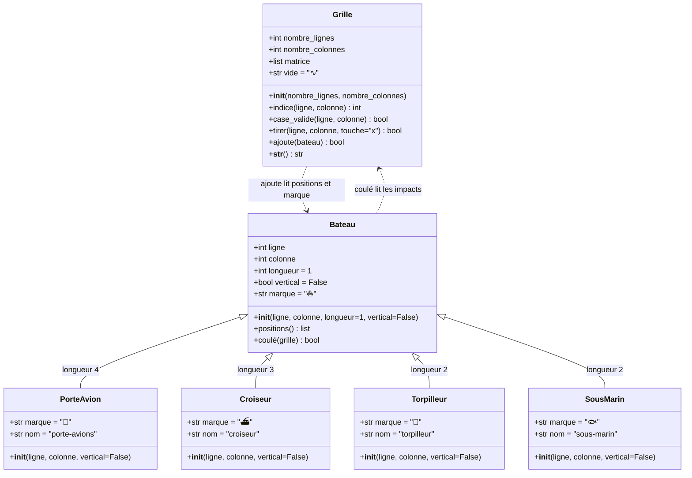
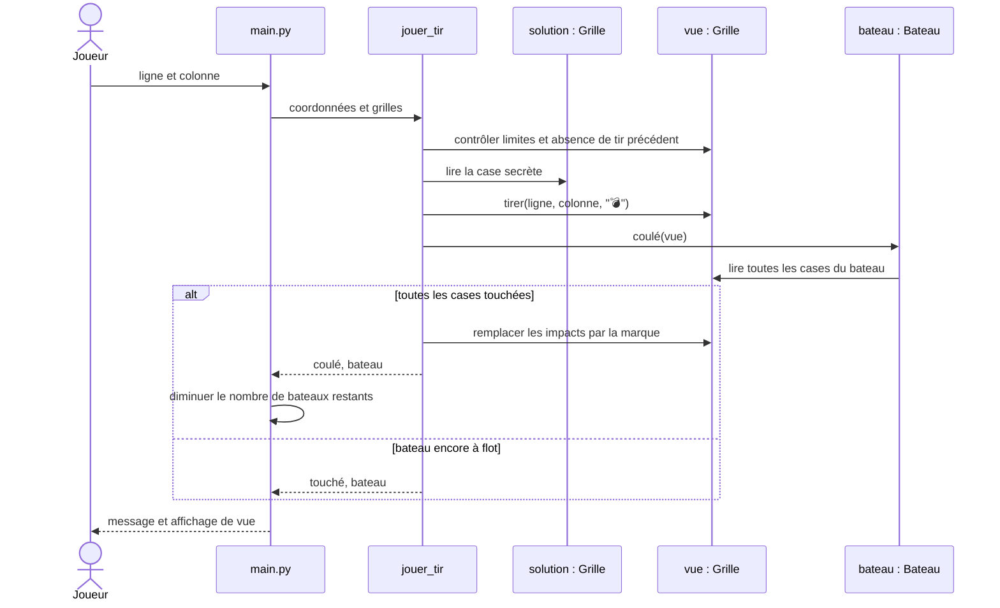

# Diagrammes UML

## Classes

`solution` et `vue` sont deux objets `Grille`, et non deux classes différentes.
Les fonctions `creer_partie` et `jouer_tir` sont définies dans `jeu.py`.

## Un tir sur un bateau

